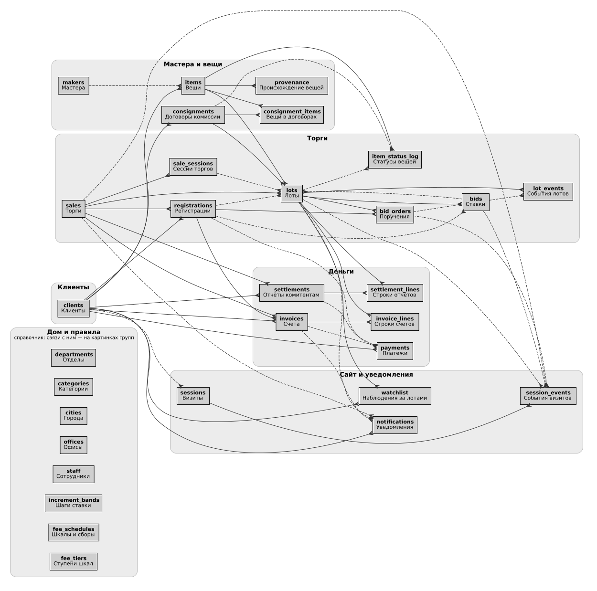
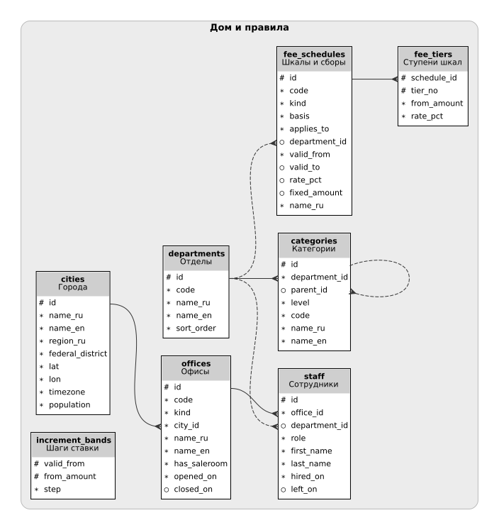
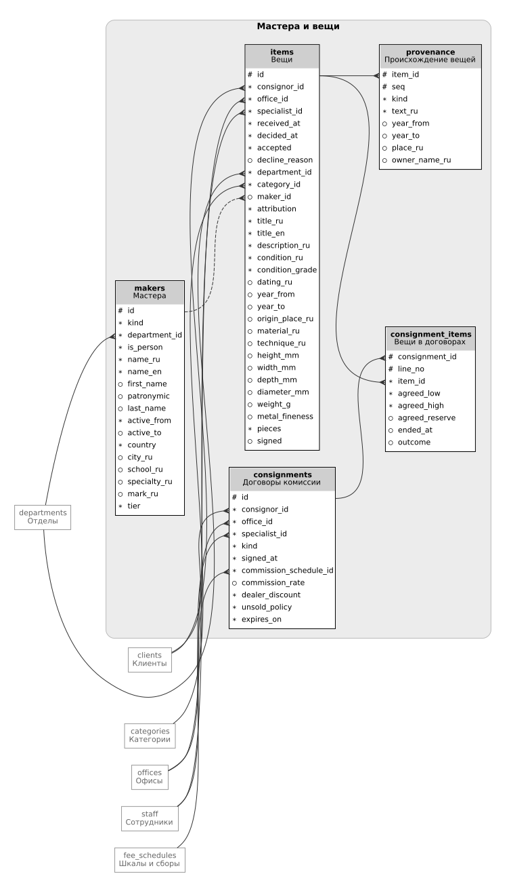
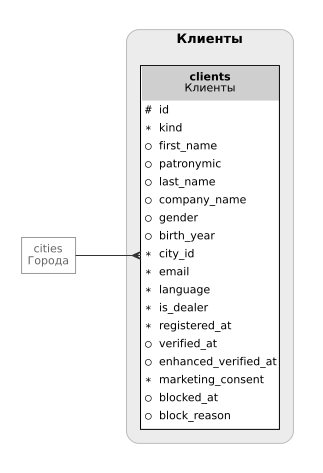
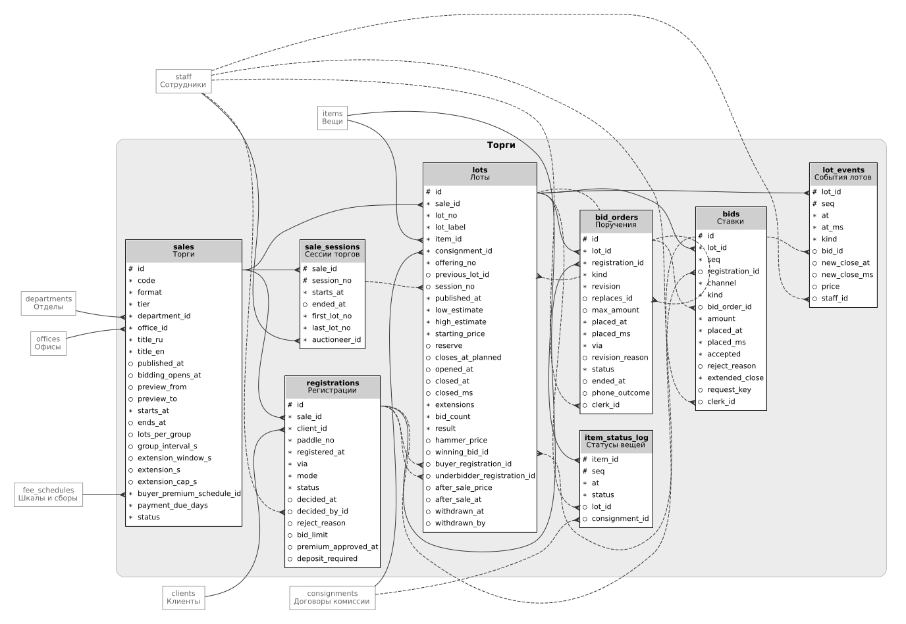
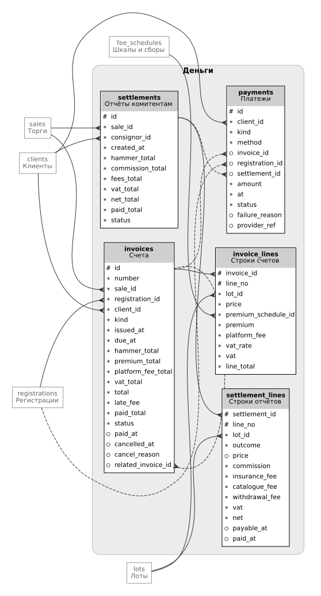
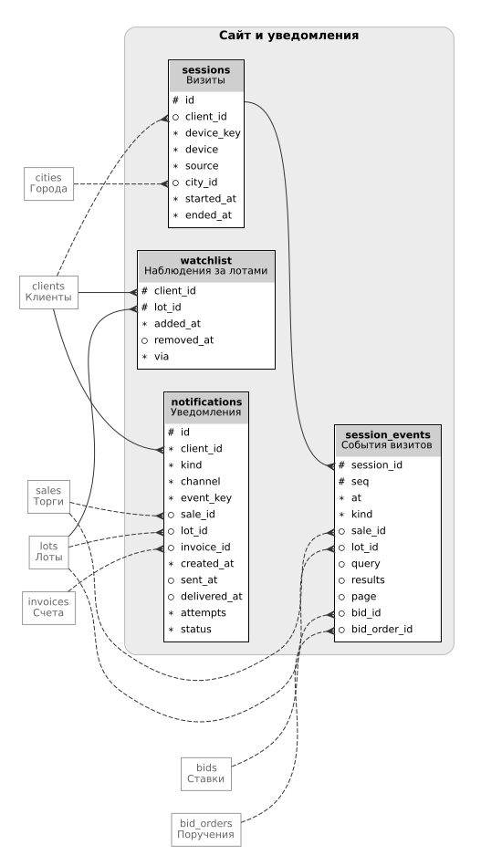

# `auc` — генератор набора «Дом Одина»

«Дом Одина» (англ. Odin's House) — синтетический аукционный дом искусства и коллекционных предметов: приём вещей от
комитентов, каталоги, онлайн- и живые торги, ставки, счета покупателям и расчёты с комитентами, сайт и уведомления;
Россия, рубли, период 01.10.2025 – 30.10.2027 («сейчас» — 01.09.2027). Шесть отделов: живопись и графика; ювелирные
украшения и часы; монеты и медали; книги, рукописи, карты; декоративно-прикладное искусство; коллекционные предметы. Всё
выдумано — дом, мастера, вещи, клиенты, сотрудники; города — таблица `cities` выпуска `sto-data-v1` как есть, с теми же
`id`. Набор — выпуск `auc-data-v1` этого репозитория (31 таблица, ≈ 135 млн строк в `full`); здесь — генератор, из
которого он собран. Устроен по общему шаблону наборов (см. `README.md` в корне): ядро — `core/`, сборка —
`./build.sh auc`, проверка — `tools/check_data.py`, CI — `.github/workflows/data.yml`.

## Схема



Карта: все таблицы по группам, связи между таблицами (одна стрелка на пару). Связи в справочник «Дом и правила» на
карте не рисуются, иначе паутина, — они на картинках групп. На картинке группы — все поля её таблиц и, серой рамкой,
таблицы других групп, на которые они ссылаются; кто ссылается на группу — на картинке своей группы:

**Дом и правила** — справочник: отделы, категории, города, офисы, сотрудники, шаги ставки, шкалы и сборы



**Мастера и вещи** — мастера, вещи, происхождение, договоры комиссии



**Клиенты** — покупатели и комитенты



**Торги** — торги, сессии живых торгов, лоты, регистрации, поручения, ставки, журналы лота и вещи



**Деньги** — счета и их строки, платежи, отчёты комитентам



**Сайт и уведомления** — визиты и их события, наблюдение за лотами, уведомления



Значки у полей: `#` — поле первичного ключа, `∗` — обязательное (NOT NULL), `○` — может быть пустым (NULL). Линия
связи идёт от поля к полю: «вилка» — у таблицы, где строк много, у таблицы «одного» значка нет; пунктир — ссылка может
быть пустой или связь только смысловая (по смыслу ссылка есть, внешнего ключа нет); смысловая связь: `lots`
(`sale_id`, `session_no`) → `sale_sessions` — сессия живых торгов; у онлайн-лотов её нет.

Поля таблиц — [`schema/schema-fields.md`](schema/schema-fields.md). Картинки пишет генератор (`schema*.dot`), рисует
Graphviz — `tools/schema-svg.sh auc`; те же картинки — в выпуске (`schema*.svg`).

Как устроен мир — дом и правила, мастера и вещи, клиенты, календарь торгов, торги и их узоры, деньги, сайт, заложенные
отклонения — описано в `SOURCE.md` выпуска (его пишет генератор вместе с данными).

Генератор — Java 25 без зависимостей (JUnit 5 — только для тестов), MIT.

## Раскладка

| путь | что |
|---|---|
| `dataset.properties` | паспорт набора: код, версия, профили, вход (`cities.tsv.gz` из `sto-data-v1` и его `sha256_tsv`), окружение выпуска, куча и бюджет `full` |
| `src/main/java/io/hammerhall/data/auc/` | домен: `AucDataset` (контракт с ядром), `Main`, описание схемы `AucSchema`, тексты `SOURCE.md` (`AucDocs`); модули `house` (дом, правила), `people` (клиенты), `catalog` (мастера, вещи), `auction` (календарь, каталоги, регистрации, торги), `bid` (движок торгов), `money` (счета и расчёты), `site` (сайт и уведомления), `text` (тексты лотов), общий мир модулей — `world` |
| `src/main/resources/io/hammerhall/data/auc/` | словари текстов лотов (`vocab/`) |
| `src/test/java/io/hammerhall/data/auc/` | тесты JUnit 5: общие тесты набора (`AucContractTest`), выпуск (`AucReleaseTest`: два прогона — один выпуск, продление периода), правила торгов и движка, подготовка торгов, деньги, сайт, тексты |
| `schema/` | DDL выпуска (`schema-tables.sql`, `schema-constraints.sql`), ER-диаграмма `schema.mmd`, поля `schema-fields.md`, картинки схемы `schema*.dot` — генерируются командой `schema`; тест и CI сверяют их с генератором; `schema*.svg` — из `schema*.dot` (`tools/schema-svg.sh auc`), тест сверяет отметку sha256 |
| `expected/` | ожидания выпуска по профилям (`auc-data-v1-small.json`, `auc-data-v1-full.json`) — для проверки скачанного выпуска |
| `pg-check.sql` | контрольные запросы для `tools/pg-check.sh` (деньги — контрольные примеры и пересчёт счетов, оплат, депозитов и отчётов комитентам; торги — сетка шагов, мягкое закрытие, повторы запросов) |
| `pom.xml` | модуль Maven `auc-gen` (для IDE; сборка — `build.sh` в корне) |

Ядро (`io.hammerhall.data.core.*`: случайность от ключа сущности, календарь и налоги, деньги, описание схемы, запись
TSV.gz, самопроверки, выпуск, командная строка) — в `core/` корня, общее для всех наборов.

## Сборка

Из корня репозитория; нужны JDK 25 (`JAVA_HOME`) и bash (на Windows — Git Bash).

```bash
mvn -B -q -pl core dependency:resolve   # один раз: JUnit 5 — в ~/.m2 (или любым другим способом)
./build.sh auc                          # собрать ядро и набор (предупреждения — ошибки) и прогнать тесты
./build.sh auc compile                  # только собрать
```

Тестам нужен `cities.tsv.gz` из выпуска `sto-data-v1`: путь — `AUC_CITIES` (или `-Dauc.cities=…` у Maven); по
умолчанию — `auc/work/cities.tsv.gz` (папка `work/` в git не попадает). Без него сборочные тесты пропускаются, а в
CI (`CI` задана) пропуск — провал.

## Генерация

```bash
./build.sh auc run generate --profile small --out auc-data-v1-small --cities sto-data-v1/cities.tsv.gz
JAVA_XMX=5g ./build.sh auc exec generate --profile full --out auc-data-v1 --cities sto-data-v1/cities.tsv.gz --inputs strict
```

`run` — собрать и запустить, `exec` — запустить собранное. Параметры: `--seed N` (по умолчанию 20261018),
`--modules a,b` (часть модулей — с зависимостями), `--to YYYY-MM-DD` (короче период), `--gzip 1..9` (по умолчанию 6:
на содержимое не влияет), `--inputs strict` (вход обязан совпасть с эталоном `sto-data-v1`), `--cities ПУТЬ` (иначе —
`AUC_CITIES` или `auc/work/cities.tsv.gz`). Куча — `JAVA_XMX` (по умолчанию 4g; для `full` — 5g, как в паспорте),
временные файлы проверок — `JAVA_OPTS=-Ddata.tmpdir=…` (по умолчанию системная папка).

| профиль | что | строк | сжатого | время |
|---|---|---|---|---|
| `small` | масштаб ≈ 1 % | ≈ 1,3 млн | ≈ 23 МБ | ≈ 10 с |
| `medium` | масштаб ≈ 10 % | ≈ 13,3 млн | ≈ 230 МБ | ≈ 1 мин |
| `full` | весь мир | ≈ 135 млн | ≈ 2,3 ГБ | ≈ 8 мин, ≤ 5 ГБ кучи на 2 ядрах |

Профиль — прогон в масштабе, а не вырезка: дом, правила и календарь торгов одинаковы во всех профилях, вещей,
клиентов, лотов и ставок меньше; идентификаторы между профилями не общие. Перед записью манифеста генератор
проверяет себя: у каждой таблицы — первичный ключ и UNIQUE, каждая ссылка, доменные инварианты модулей и узоры
данных (коридоры). Провал — манифест не пишется, выпуск не годен. Коридоры узоров рассчитаны на `full`; у меньших
профилей они шире, а доли каналов живых торгов только печатаются: каталог живых торгов там меньше полного.

Другие команды: `schema [--out DIR]` (DDL, ER-диаграмма, поля, картинки схемы в DOT — без данных; по умолчанию — в
`auc/schema/`; SVG из DOT — `tools/schema-svg.sh auc`),
`verify DIR` (файлы против `manifest.json`), `names ПУТЬ` (нет ли внутренних имён платформы), `freeze DIR` и
`check DIR` — ниже.

## Тождество выпуска

Тот же seed и та же версия генератора — то же **содержимое** на Linux и Windows. Тождество — то, что от сборки
zlib не зависит:

* у каждой таблицы — число строк и `sha256_tsv` (sha256 разжатого TSV);
* поля `manifest.json`, кроме списка файлов (версия, генератор, seed, профиль, период, модули, входы, формат);
* sha256 текстов без сжатия: `LICENSE`, `schema-tables.sql`, `schema-constraints.sql`, `schema.mmd`,
  `load-postgres.psql`, картинки схемы `schema*.svg`;
* контрольные агрегаты таблиц (суммы, минимумы, число NULL и т. п.) — показывают, *что* разошлось.

**Справочно** — байты и `sha256` файлов `.tsv.gz`, а с ними `manifest.json` целиком и `SOURCE.md` (размеры в нём —
по сжатым байтам). Сжатие — `java.util.zip` (zlib в составе JDK): одна и та же сборка JDK даёт одни байты, а другая
реализация zlib — другие байты того же содержимого. `sha256` сжатого файла сверяется с `manifest.json` того же
выпуска — это проверка скачивания, а не тождества.

## Проверка скачанного выпуска

Скачайте файлы выпуска в одну папку и проверьте их против ожиданий из репозитория (на теге выпуска), из корня:

```bash
python3 -X utf8 -I tools/check_data.py ПАПКА_ВЫПУСКА             # Linux, macOS
py -3 -X utf8 -I tools\check_data.py ПАПКА_ВЫПУСКА               # Windows
./build.sh auc exec check ПАПКА_ВЫПУСКА                          # то же — генератором (Java)
```

Ожидания берутся из `auc/expected/<версия>-<профиль>.json` (версия и профиль — из `manifest.json` выпуска), другой
файл — `--expected ФАЙЛ`. `--no-aggregates` (у Java — `--aggregates no`) — только строки и sha256: быстрее на `full`.
Итог — «ВЫПУСК В ПОРЯДКЕ» (код 0) или «ВЫПУСК НЕ СОВПАЛ С ОЖИДАНИЯМИ» (код 1) и что именно разошлось.

Загрузка в Postgres — из папки выпуска:

```bash
psql -v ON_ERROR_STOP=1 -d БАЗА -f schema-tables.sql -f load-postgres.psql -f schema-constraints.sql
```

Проверка загрузкой во временный Postgres 16 (Linux) — `tools/pg-check.sh ПАПКА_ВЫПУСКА` из корня.

## Новый выпуск

1. Изменили генератор — подняли его версию (`AucDataset.GENERATOR_VERSION`), если меняется содержимое; новая версия
   набора — `AucSchema.VERSION` и `version` в `dataset.properties` (тест контракта сверяет их).
2. Ожидания: `./build.sh auc exec freeze ПАПКА_SMALL` и `./build.sh auc exec freeze ПАПКА_FULL` (пишут
   `auc/expected/<версия>-<профиль>.json`) — локально или ручным запуском workflow `data` с набором `auc` (артефакты
   `expected-*`). Схема: `./build.sh auc exec schema`, картинки — `tools/schema-svg.sh auc`. Всё — в коммит.
3. Тег `auc-data-v1` → CI собирает и проверяет; выпуск выкладывается после одобрения в окружении `auc-data-release`.

## CI

Общий workflow `.github/workflows/data.yml` (см. `README.md` в корне); для набора «Дом Одина» — тег `auc-data-v*` или
ручной запуск с `dataset` = `auc`. Вход `cities.tsv.gz` CI берёт из выпуска `sto-data-v1` и сверяет с паспортом; куча
`full` — 5 ГБ, бюджет — 60 мин (паспорт).

## Лицензия

MIT — и данные, и генератор. Города (названия, координаты, пояса) — таблица `cities` выпуска `sto-data-v1` (MIT); тот
берёт их из `air-data-v1`, MIT © 2025 Postgres Professional.
