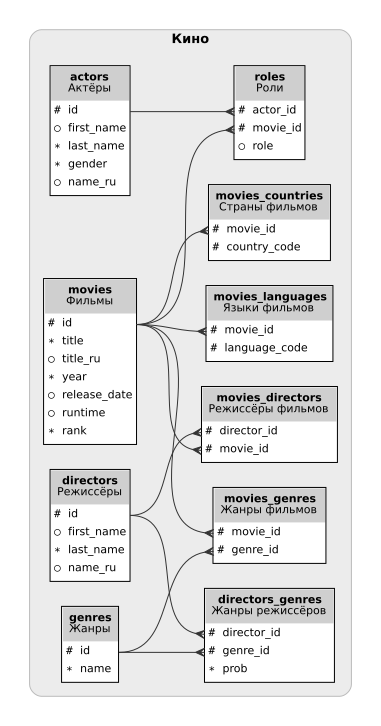
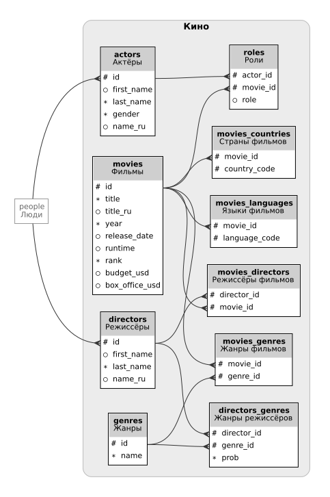
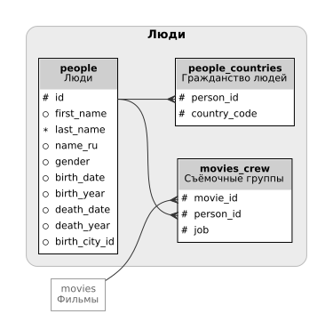
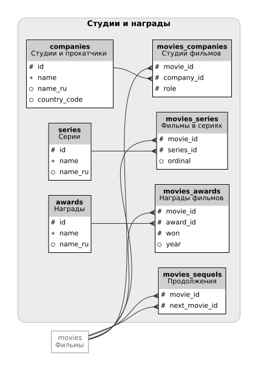
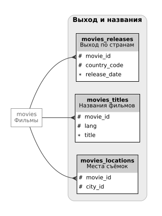
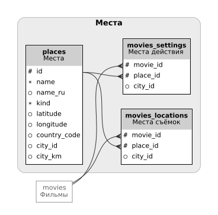

# `mov` — набор «Кино»

Выпуск `mov-data-v1`: фильмы, актёры, режиссёры и роли из Wikidata — художественные, короткометражные, анимационные,
документальные фильмы, телефильмы и немое кино (без фильмов для взрослых, клипов, трейлеров, сериалов и серий
фильмов): 25 таблиц — жанры (словарь из 24 жанров), фильмы (название по-английски и по-русски, год и дата выхода,
хронометраж, рейтинг, бюджет и сборы в долларах США), актёры (имя, фамилия, пол, имя по-русски), режиссёры, роли и
связи фильмов с режиссёрами, жанрами, странами и языками, жанры режиссёров; люди (все актёры, режиссёры и съёмочная
группа: даты жизни, место и город рождения, гражданство) и съёмочные группы фильмов; студии и прокатчики (со
штаб-квартирой), серии и продолжения, награды и номинации; выход по странам, названия на языках; места съёмок и
действия, места — с координатами и ближайшим городом набора «Мир». Названия, имена, даты, суммы, координаты и коды —
как в Wikidata на дату снимка; **рейтинг фильма — синтетический** (не оценка качества, см. «Правила»). Плюс
19 таблиц **синтетики** онлайн-кинотеатра «Свартальвхейм» вокруг настоящих фильмов профиля (модуль `site`, см.
«Синтетика»). Что сделано с данными и какие поля в таблицах — `SOURCE.md` выпуска.

## Схема



Карта: все таблицы по группам, связи между таблицами (одна стрелка на пару). На картинке группы — все поля её таблиц
и, серой рамкой, таблицы других групп, на которые они ссылаются; кто ссылается на группу — на картинке своей группы:

**Кино** — фильмы и жанры, актёры и роли, режиссёры, страны и языки фильмов



**Люди** — все люди фильмов профиля (актёры, режиссёры, съёмочная группа), их гражданство, съёмочные группы фильмов



**Студии и награды** — студии и прокатчики, серии фильмов и продолжения, награды и номинации



**Выход и названия** — даты выхода по странам, названия на языках



**Места** — места съёмок и действия фильмов, рождения людей, штаб-квартиры студий — с координатами и городом «Мира»



Значки у полей: `#` — поле первичного ключа, `∗` — обязательное (NOT NULL), `○` — может быть пустым (NULL). Линия
связи идёт от поля к полю: «вилка» — у таблицы, где строк много, у таблицы «одного» значка нет. id фильмов, людей,
студий, серий, наград и мест — номер элемента Wikidata (`Q42` → 42): один человек может быть и в `actors`, и в
`directors`, и в `movies_crew` под одним id, в `people` — один раз (`actors.id` и `directors.id` ссылаются на
`people`). Места (`places`) — внешние ключи из `movies_locations`, `movies_settings`, `people.birth_place_id`,
`companies.hq_place_id`. Город (`places.city_id` и его копии `movies_locations.city_id`, `movies_settings.city_id`,
`people.birth_city_id`, `companies.hq_city_id`) — id города набора «Мир» (`wld-data-v1`, `cities.id` = geonameid):
связь между наборами мягкая, внешнего ключа нет. Внешние ключи DDL ставятся после загрузки (`schema-constraints.sql`).

Поля таблиц — [`schema/schema-fields.md`](schema/schema-fields.md). Картинки пишет генератор (`schema*.dot`), рисует
Graphviz — `tools/schema-svg.sh mov`; те же картинки — в выпуске (`schema*.svg`).

Генератор здесь — **импорт**: входы — снимок Wikidata `mov-source-YYYYMMDD.zip` (выпуск этого репозитория; нужен
снимок v3 — с координатами мест, местами действия и штаб-квартирами) и города набора «Мир» `cities.tsv.gz` (выпуск
`wld-data-v1`), выход — 25 таблиц.
Случайность — только в рейтинге и в поле «пол» там, где источник молчит: от seed набора и id (`core.random`). Устроен
по общему шаблону наборов (см. `README.md` в корне): ядро — `core/`, сборка — `./build.sh mov`, проверка —
`tools/check_data.py`, CI — `.github/workflows/data.yml`. Java 25 без зависимостей (JUnit 5 — только для тестов).

## Раскладка

| путь | что |
|---|---|
| `dataset.properties` | паспорт набора: код, версия, профили, входы — снимок (`mov-source-20261125.zip` из выпуска `mov-source-20261125` и его `sha256`) и города «Мира» (`cities.tsv.gz` из выпуска `wld-data-v1` и его `sha256_tsv`), окружение выпуска |
| `source/` | снимок Wikidata: загрузчик `fetch.py` (только стандартная библиотека Python) и его тесты без сети `test_fetch.py`; запускает CI `.github/workflows/source.yml` по тегу `mov-source-YYYYMMDD`, выпуск снимка — после одобрения в том же окружении `mov-data-release` |
| `src/main/java/io/hammerhall/data/mov/` | `MovDataset` (контракт с ядром), `Main`, схема `MovSchema`, тексты выпуска `MovDocs` (SOURCE.md и LICENSE), список кодов `Exclusions` (страны и места, места — из ресурса `excluded-places.txt`) |
| `…/mov/source/` | чтение снимка: `Snapshot` (zip и `.csv.gz` внутри него потоком), `Csv` (RFC 4180), `Wikidata` (номера элементов, годность текста для TSV, языки меток), всё вместе — `SourceData` (все файлы снимка обязательны: нет файла — ошибка с его именем до чтения); `SnapshotSource` — снимок прогона (разбирается один раз); города «Мира» — `WorldCities` (id, страна, координаты, ближайший город страны, sha256 содержимого) и `CitiesSource` (читаются один раз) |
| `…/mov/site/` | синтетика «Свартальвхейм»: модуль `SiteModule` (19 таблиц), схема `SiteSchema`, вход `SiteInput` (переходник от `Cinema`: серии и продолжения — для узора «по порядку»), тарифы `Plans`, промокоды `Promos`, города и их пояса `Cities` (ресурс `cities.tsv` из «Мира»), каталог `Catalog`, пользователи `Audience`, жизнь пользователя `Life`, подписки на людей и голоса `Social`, самопроверка `SiteAudit`, раздел SOURCE.md `SiteDocs`; тексты по-русски — `text/` (`SiteTexts`, словарь фраз `SiteTextsRu`, ресурсы `site/text/`) |
| `…/mov/build/` | правила сборки: фильмы (год и название с запасными путями), бюджет и сборы, даты жизни, город, серии, награды, выход по странам, названия, роли, коды, доли, профили — `Rules`; жанры и таблица якорей — `Genres`; имена и пол — `Names`; рейтинг — `Rank`; места (название, вид, страна, координаты, город «Мира» по GeoNames ID или ближайший) — `Places`; набор целиком `Cinema` (функция снимка, городов, профиля, seed и списка кодов), модуль `CinemaModule` (все таблицы и самопроверка) |
| `src/test/java/io/hammerhall/data/mov/` | тесты JUnit 5: общие тесты набора (`MovContractTest`), правила по одному (`RulesTest`, `GenresTest`, `NamesTest`, `RankTest`, `PlacesTest`), чтение снимка (`CsvTest`), набор из крошечного снимка (`CinemaTest`), выпуск целиком и тексты (`MovReleaseTest`); крошечный снимок v3 и крошечные города «Мира» для тестов (все файлы, по ветке на правило) — `TinySnapshot` |
| `schema/` | DDL выпуска (`schema-tables.sql`, `schema-constraints.sql`), ER-диаграмма `schema.mmd`, поля `schema-fields.md`, картинки схемы `schema*.dot` (карта и по картинке на группу) — генерируются командой `schema`; тест и CI сверяют их с генератором; `schema*.svg` — из `schema*.dot` (`tools/schema-svg.sh mov`), тест сверяет отметку sha256 |
| `expected/` | ожидания выпуска по профилям (`mov-data-v1-small.json`, `mov-data-v1-medium.json`, `mov-data-v1-full.json`) — из настоящего снимка |
| `pom.xml` | модуль Maven `mov-gen` (для IDE; сборка — `build.sh` в корне) |

## Сборка

Из корня репозитория; нужны JDK 25 (`JAVA_HOME`) и bash (на Windows — Git Bash).

```bash
./build.sh mov            # собрать ядро и набор (предупреждения — ошибки) и прогнать тесты
./build.sh mov compile    # только собрать
```

Тестам входы не нужны: без них вход — крошечный снимок и крошечные города, которые тест пишет сам (`TinySnapshot`;
фильмы, люди, места и города в них выдуманы). С настоящими (`MOV_SOURCE` и `MOV_CITIES`, `-Dmov.source=…` и
`-Dmov.cities=…` у Maven или `mov/work/mov-source-20261125.zip` и `mov/work/cities.tsv.gz`) общие тесты собирают
`small` из них; каждый вход — сам по себе.

## Генерация

```bash
./build.sh mov run generate --profile small --out mov-data-v1-small --source mov-source-20261125.zip --cities cities.tsv.gz
./build.sh mov exec generate --profile full --out mov-data-v1 --source mov-source-20261125.zip --cities cities.tsv.gz --inputs strict
```

`--source ПУТЬ` — иначе `MOV_SOURCE` или `mov/work/mov-source-20261125.zip`; `--cities ПУТЬ` — иначе `MOV_CITIES` или
`mov/work/cities.tsv.gz`. `--inputs strict` — sha256 снимка обязан совпасть с паспортом, имя снимка в его `fetch.json` —
с `MovDataset.SNAPSHOT`, sha256 содержимого городов — с паспортом (`input.cities.sha256_tsv`, оно же
`MovDataset.CITIES`). `--seed` меняет рейтинг и пол там, где
источник молчит (по умолчанию — 20261123). `--to` меняет только конец окна синтетики (кино от окна не зависит). Куча —
`JAVA_XMX`; `full` — до 5 ГБ (пик ≈ 4 ГБ).

| профиль | фильмы | фильмов | пользователей «Свартальвхейма» | всего строк | сжато |
|---|---|--:|--:|--:|--:|
| `small` | 1 % самых известных | 3 843 | 1 468 | 395 311 | ≈ 4,6 МБ |
| `medium` | 10 % самых известных | 38 428 | 14 927 | 2 208 727 | ≈ 24 МБ |
| `full` | все | 384 274 | 147 996 | 10 726 108 | ≈ 123 МБ |

Жанров (24) — во всех профилях; рейтинг фильма — один во всех профилях. Числа — по снимку `mov-source-20261125`;
точные — в `expected/`.

### Снимок источников

Снимок собирает CI (из песочницы Wikidata не видна) и кладёт в выпуск `mov-source-YYYYMMDD`: zip без общей папки,
записи по имени, время записей — 1980-01-01. Данные — CSV UTF-8 с заголовком (как пишет модуль `csv` Python), Q-id —
строкой `Q123`; большие таблицы — `.csv.gz` внутри zip. Фильмов для взрослых в снимке нет: загрузчик убирает их до
выгрузки состава и людей.

| путь | что |
|---|---|
| `fetch.json`, `SOURCE.md`, `SHA256SUMS` | имя и время снимка, запросы и суммы файлов, источник и лицензия |
| `wikidata/queries/*.rq` | тексты запросов SPARQL |
| `wikidata/classes.csv` | классы фильмов из загрузчика: включён (`1`) или нет (`0`) |
| `wikidata/films.csv.gz` | фильмы и их классы P31 |
| `wikidata/film_dates.csv.gz`, `film_labels.csv.gz`, `film_titles.csv.gz`, `film_durations.csv.gz` | P577 (с точностью и рангом), метки (`en mul ru de fr es it pt nl sv pl`), P1476, P2047 в секундах |
| `wikidata/film_links.csv.gz` | P136 (жанр), P57 (режиссёр), P495 (страна), P364 (язык) |
| `wikidata/film_signals.csv.gz` | признаки известности: статей в разделах (sitelinks), наград P166, номинаций P1411; ID IMDb P345 — только для отсева дублей |
| `wikidata/film_cast.csv.gz` | состав P161 и P725 с ролями: персонаж P453, имя роли P4633 |
| `wikidata/genre_items.csv` | элементы жанров и классов и их P279 (вверх до корня) |
| `wikidata/people.csv.gz`, `people_labels.csv.gz`, `people_names.csv.gz`, `name_items.csv.gz` | люди (из P57, состава и съёмочной группы): P31 = человек, P21, метки; имена P735 и фамилии P734 и их элементы (метки, вид: мужское, женское, …) |
| `wikidata/countries.csv`, `languages.csv`, `characters.csv.gz` | коды стран (P297, P298) — всех, что сборка спрашивает как страну (P495, P291, P27, P17), — и языков (P218, P220), метки персонажей |
| `wikidata/film_dates_extra.csv.gz` | запасные даты года: P1191 (первый показ), P571 (создание), P2754 (дата производства) — с точностью и рангом |
| `wikidata/film_labels_all.csv.gz` | все метки фильмов, у которых нет ни метки из `en mul ru de fr es it pt nl sv pl`, ни P1476 |
| `wikidata/film_releases.csv.gz` | P577 с местом публикации P291 (по строке на утверждение и место) |
| `wikidata/film_crew.csv.gz` | съёмочная группа: P58 (сценарист), P86 (композитор), P344 (оператор), P162 (продюсер), P1040 (монтажёр) |
| `wikidata/film_links2.csv.gz` | P272 (студия), P750 (прокатчик), P915 (место съёмок), P155 и P156 (предыдущий и следующий фильм), P840 (место действия) |
| `wikidata/film_series.csv.gz`, `film_money.csv.gz`, `film_awards.csv.gz` | серии P179 с номером P1545; бюджет P2130 и сборы P2142 (сумма, валюта, ранг); награды P166 и номинации P1411 с датой P585 |
| `wikidata/people_dates.csv.gz`, `people_links.csv.gz` | рождение P569 и смерть P570 (с точностью и рангом); место рождения P19 и гражданство P27 |
| `wikidata/places.csv.gz`, `item_labels.csv.gz`, `companies.csv` | места (P19, P915, P840, P159): GeoNames ID P1566, страна P17, метки `en`, `mul` и `ru`, координаты P625 (глобус Земли); метки `en mul ru` студий, прокатчиков, серий и наград; страна P17 и штаб-квартира P159 студий и прокатчиков |

## Синтетика «Свартальвхейм»

Выдуманный русскоязычный онлайн-кинотеатр (с 2019 года) и его сообщество вокруг **настоящих** фильмов профиля:
тарифы и цены, промокоды, пользователи и устройства, каталог с окнами прав, подписки и оплаты, прокат и покупки,
просмотры, оценки, рецензии по-русски и голоса за них, списки «посмотреть», подписки друг на друга, подборки и теги.
Люди сервиса и их действия выдуманы; `movie_id` — фильм профиля, `city_id` — город World (`wld-data-v1`, geonameid),
мягкой ссылкой; суточный ход просмотров — по поясу города. Окно — как у «Кременъ»: `Period(2025-10-01, 2027-10-30,
«сейчас» 2027-09-01T00:00:00Z, Москва)`; срез фактов — min(«сейчас», конец окна + 1 сутки); `id` — по моменту
появления, продление окна не меняет историю (тест `SiteReleaseTest.extendingThePeriodKeepsHistory`). Пользователей:
`full` — ≈ 148 тыс., `medium` — 10 %, `small` — 1 % (масштабом); каталог — ≈ 17 % фильмов профиля. Скрытая модель
вкуса и оценки, узоры, заложенные отклонения и самопроверки (`SiteAudit`: правила домена, `CHECK` схемы, коридоры
узоров) — в коде модуля и `SOURCE.md` выпуска.

## Правила

По одному месту в коде на правило (`Rules`, `Genres`, `Names`, `Rank`, `Cinema`); модульные тесты — на каждое.
Текст источника, в котором есть знаки, которых нет в TSV (обратная косая, табуляция, переводы строк, управляющие), —
как отсутствующий.

* **Фильм** — элемент из `films.csv`: среди классов нет исключённых (клип, трейлер, проект, серия фильмов; и классы
  `classes.csv` с `included = 0`), есть год и название. Год — самой ранней даты P577 с точностью не ниже года среди
  утверждений лучшего ранга (`preferred`, если они есть, иначе `normal`), от 1874 до года снимка; такой нет — по
  очереди P1191, P571, P2754, каждое тем же правилом. `release_date` — только из P577: самая ранняя дата с точностью
  до дня среди тех же утверждений. `title` — метка `en` → `mul` → P1476 (сначала `en`, затем по языку) → метка
  запасного языка (`de fr es it pt nl sv pl`) → метка `ru` (тогда `title` = `title_ru`) → метка на любом языке
  (`film_labels_all`: языки по байтам кода, первая годная); `title_ru` — метка `ru`. Число фильмов по каждому пути
  года и названия — в `SOURCE.md` и `manifest.json`.
  `runtime` — из значений P2047 / 60 (половина — к чётному по точной записи: 88,5 → 88), попавших в 1–1 500 минут, —
  наименьшее; нет — пусто. Дубли по IMDb: остаётся фильм с большим sitelinks, затем с меньшим id.
* **Бюджет и сборы** (`movies.budget_usd`, `box_office_usd`) — P2130 и P2142 только в долларах США (Q4917): из таких
  сумм — лучшего ранга, наибольшая, целое (половина — к чётному по точной записи); не больше нуля — пусто. Другие
  валюты не пересчитываются и не берутся.
* **Жанры** — словарь из 24 жанров ровно как в прежнем наборе фильмов (`Adult` в словаре есть, фильмов в нём нет).
  Жанры фильма — объединение: по классу (анимация — `Animation`, документальный — `Documentary`, короткометражный —
  `Short`), `runtime ≤ 40` — `Short`, по P136: значение и его предки по P279 вширь (глубина ≤ 6) — первый уровень, где
  встретились якоря (`Genres.ANCHORS`: элемент Wikidata → жанры словаря), даёт жанры всех якорей уровня; составной
  жанр (романтическая комедия, комедийная драма, нео-нуар …) — два жанра.
* **Люди** — элементы с P31 = человек: режиссёры — из P57, актёры — из P161 и P725 фильмов профиля. Полное имя — метка
  `en` → `mul` → первая метка запасного языка, без одного уточнения «(…)» в конце; без имени человека (и его связей)
  нет. Фамилия F — первая P734 (по P1545: числа, затем прочее, затем пусто; затем по номеру), если полное имя равно
  F, оканчивается на «␣F» или начинается с «F␣» (метка `en`, иначе `mul`); иначе — последнее слово с частицами перед
  ним (`van von de da di del della der den du la le ter ten bin ibn al`, с учётом регистра) и суффиксом после
  (`Jr. Sr. II III IV`); одно слово — имени нет. `name_ru` — метка `ru` целиком.
* **Пол** (`actors.gender`) — только `M` или `F`, всегда: P21 (мужской и Q2449503 — `M`, женский и Q1052281 — `F`);
  человек с иным значением P21 в актёры не берётся (с его ролями), в режиссёры — да. P21 нет — по первому имени P735
  (`male` — `M`, `female` — `F`); иначе — от seed и id (поток `actors.gender`): `F` с вероятностью доли `F` среди
  актёров `full` с полом из источника — пол актёра один во всех профилях. Число актёров профиля по каждому пути — в
  `SOURCE.md` и `manifest.json`.
* **Люди** (`people`) — каждый актёр, режиссёр и член съёмочной группы профиля один раз; имя и фамилия — как выше.
  Пол — как у актёров (у актёра — то же значение, что в `actors`), но человек с иным значением P21 — с пустым полом.
  Даты жизни — P569 и P570 лучшего ранга: дата — самая ранняя с точностью до дня, год — самой ранней с точностью не
  ниже года; год вне 1700 … года снимка — пусто (дата — тоже); смерть — только при рождении не позже неё (дата — при
  дате, год — при годе). `birth_place_id` — первое по номеру место P19 из тех, что берутся в `places` (нет таких —
  пусто), `birth_city_id` — город этого места (`places.city_id`).
  Гражданство (`people_countries`) — ISO3 значений P27, как страны фильмов.
* **Съёмочная группа** (`movies_crew`) — P58 `writer`, P86 `composer`, P344 `cinematographer`, P162 `producer`, P1040
  `editor`; человек — элемент-человек с именем (как режиссёр).
* **Студии и прокатчики** (`companies`, `movies_companies`) — значения P272 (`production`) и P750 (`distribution`) с
  меткой `en`, иначе `mul` (нет — не берутся); `name_ru` — метка `ru`; страна — ISO3 первой по номеру P17;
  `hq_place_id` — место P159 (первое по номеру), если оно берётся в `places` (иначе пусто), `hq_city_id` — город
  этого места.
* **Серии и продолжения** — `series`: значения P179 с меткой `en` → `mul`; номер в серии (`movies_series.ordinal`) —
  наименьшее целое P1545 пары «фильм, серия» от 1 до 10 000, иначе пусто. `movies_sequels` — пары из P156 (фильм →
  следующий) и обратного P155 (предыдущий → фильм), оба фильма в профиле, фильм сам себе — нет.
* **Награды** (`awards`, `movies_awards`) — значения P166 (`won` = `t`) и P1411 (`f`) с меткой `en` → `mul`; год — самый
  ранний год P585 с точностью не ниже года среди строк тройки «фильм, награда, `won`»; выиграл и номинирован — две
  строки.
* **Выход по странам** (`movies_releases`) — P577 с местом P291 и точностью до дня (дата по календарю): место —
  страна с ISO3 (без исключённых), иначе (город, фестиваль) строки нет; на пару «фильм, страна» — самая ранняя дата.
* **Названия** (`movies_titles`) — метки фильма на языках `LABEL_LANGS` и метки `film_labels_all`, годные, одна на
  язык (меньшая по байтам).
* **Места** (`places`) — каждое место, на которое ссылается профиль: места съёмок P915 (`movies_locations`), места
  действия P840 (`movies_settings`), места рождения (`people.birth_place_id`), штаб-квартиры (`companies.hq_place_id`).
  `name` — метка `en` → `mul`; нет — места нет (и ссылок на него). Так же нет (строки `places` нет, строк
  `movies_locations`, `movies_settings` с ним нет, `birth_place_id`, `hq_place_id` и их город — пусто): страны с кодом
  из `Exclusions`, места, чья страна P17 — с кодом из `Exclusions`, и места из списка
  `src/main/resources/io/hammerhall/data/mov/excluded-places.txt` (номера `Q…` по строке, `#` — комментарий); число таких
  мест профиля по пунктам — в `SOURCE.md` и `manifest.json`. `kind` — `country`, если у элемента есть ISO3 в
  `countries.csv` (место — сама страна), иначе `place`. `country_code` — свой ISO3 у страны, ISO3 страны P17 у места.
  Координаты — P625 (глобус Земли), 7 знаков (половина — к чётному, без хвостовых нулей); вне диапазона — нет.
* **Город места** (`city_id`, `city_km`, только у `place`) — GeoNames ID места, если он есть среди `cities.id` «Мира»
  (`city_km` = 0); иначе при координатах и стране — ближайший город «Мира» той же страны не дальше 30 км по большому
  кругу (гаверсинус, радиус 6 371,0088 км, `StrictMath`; при равенстве — меньший id), `city_km` — расстояние,
  половина — к чётному до 0,1 км по точной десятичной записи; иначе — пусто. Тот же город — в ссылках на место
  (`movies_locations.city_id`, `movies_settings.city_id`, `people.birth_city_id`, `companies.hq_city_id`). Связь с
  «Миром» мягкая, без внешнего ключа. Число мест профиля по пути города — в `SOURCE.md` и `manifest.json`.
* **Справочники профиля** — студии, серии, награды и места — только те, на кого ссылаются фильмы профиля (места —
  ещё люди и студии профиля).
* **Роли** — строка на пару «актёр, фильм»: роль — P4633, иначе метка `en` (`mul`) персонажа P453, иначе пусто; роль
  с негодными для TSV знаками — пусто; несколько ролей актёра в фильме — одной строкой через « / » (по алфавиту, без
  повторов): первичный ключ — пара, пустая роль не может быть полем ключа.
* **Документальные фильмы** (жанр `Documentary` в `movies_genres`) — актёрский состав не берётся: там снимаются
  реальные люди в роли самих себя. Строк `roles` с ними нет; актёр — только с ролью в другом фильме; в `people` — только
  те, на кого есть другая ссылка (режиссёр, съёмочная группа). Режиссёры, группа, студии, награды — как у всех фильмов;
  популярность, рейтинг и доля `F` для пола — как до этого отбора. Число документальных фильмов, не взятых ролей и
  выпавших людей — в `SOURCE.md` и `manifest.json`.
* **Страны и языки** — ISO 3166-1 alpha-3 значений P495 (без кода и коды из `Exclusions` — по ISO2 или ISO3 элемента —
  строки нет; так же гражданство, страны студий и выхода по странам); ISO 639-1, иначе ISO 639-3 значений P364.
* **Жанры режиссёров** — для режиссёра профиля и жанра его фильмов: доля его фильмов профиля с жанром среди его фильмов
  с хоть одним жанром, 4 знака (половина — к чётному).
* **Рейтинг** (`movies.rank`, 1.0–9.9, один знак) — **синтетический**: популярность
  `p = ln(1 + sitelinks) + 0.5·ln(1 + наград) + 0.25·ln(1 + номинаций) + 0.1·ln(1 + ролей в full)`; оценка
  `s = 0.6·z(p) + 0.4·n` (`z` — по фильмам `full` с `p > 0`, СКО — по генеральной совокупности; у фильма без
  признаков `z = 0` — рейтинг примерный, шум вокруг середины; `n` — N(0, 1) ядра,
  `Rng.gaussian()`: Бокс — Мюллер из двух равномерных SplitMix64, поток `movies.rank` под id фильма); место `s` среди
  всех фильмов (при равенстве — по id) → квантиль `(i + 0.5) / N` → рейтинг по кусочно-линейной обратной функции
  распределения прежнего набора (0 → 1.0, 0.01 → 1.7, 0.05 → 2.9, 0.10 → 3.6, 0.25 → 4.9, 0.50 → 6.0, 0.75 → 7.0,
  0.90 → 7.8, 0.95 → 8.4, 0.99 → 9.2, 1 → 9.9), точно (в целых), половина — к чётному. Оценки других сервисов (P444)
  не берутся.
* **Профили** — фильмы по популярности `p` (по убыванию, затем id): `full` — все, `medium` — первые 10 %, `small` —
  первый 1 % (округление вверх); люди и связи — только по фильмам профиля; рейтинг — по `full`, одинаков во всех
  профилях.

Список `Exclusions` — только коды: стран (ISO3 и ISO2, тот же, что у набора «Мир») и мест (номера элементов из
`excluded-places.txt`); строк с ними в наборе нет.

Поля, чьё содержание взято из источника без изменений (названия, имена, роли, коды, названия студий, серий, наград и
названия фильмов на языках), помечены в `MovSchema`
`verbatimSource()`: проверка внутренних имён выпуска (`names`, тест контракта) их значения пропускает — настоящие
названия и имена могут содержать любые сочетания букв. Заголовки, тексты выпуска, прочие поля и весь репозиторий
проверяются как обычно.

## Тождество и проверка выпуска

Как у всех наборов (см. `README.md` в корне): тождество — `rows` и `sha256_tsv` таблиц, поля манифеста кроме списка
файлов (имя и sha256 снимка — тоже), тексты без сжатия, агрегаты. Проверка скачанного выпуска:

```bash
python3 -X utf8 -I tools/check_data.py ПАПКА_ВЫПУСКА        # Linux, macOS
py -3 -X utf8 -I tools\check_data.py ПАПКА_ВЫПУСКА          # Windows
./build.sh mov exec check ПАПКА_ВЫПУСКА                     # то же — генератором
```

Загрузка в Postgres —
`psql -v ON_ERROR_STOP=1 -d БАЗА -f schema-tables.sql -f load-postgres.psql -f schema-constraints.sql` из папки
выпуска; проверка во временном Postgres 16 — `tools/pg-check.sh ПАПКА_ВЫПУСКА`.

## Новый выпуск

1. Снимок Wikidata — выпуск `mov-source-YYYYMMDD` этого репозитория; имя — в `MovDataset.SNAPSHOT` (дата окна — из
   него) и в `dataset.properties` (`input.source.file`, `input.source.release`); sha256 файла — в паспорте
   (`input.source.sha256`) и в `MovDataset.SOURCE`. Города «Мира» — `cities.tsv.gz` выпуска `wld-data-v1`; sha256
   содержимого — в паспорте (`input.cities.sha256_tsv`) и в `MovDataset.CITIES`.
2. Изменили генератор, таблицу якорей или список кодов так, что меняется содержимое, — новая версия генератора
   (`MovDataset.GENERATOR_VERSION`).
3. Ожидания: `./build.sh mov exec freeze ПАПКА` для `small`, `medium` и `full` (или ручной запуск workflow `data` с
   набором `mov` — артефакты `expected-*`); схема — `./build.sh mov exec schema`, картинки — `tools/schema-svg.sh mov`.
   Всё — в коммит.
4. Тег `mov-data-vN` → CI собирает и проверяет; выпуск — после одобрения в окружении `mov-data-release`.

## Лицензия

Данные — Wikidata, CC0 1.0 (текст — `LICENSE` выпуска); город места выбран по городам GeoNames из набора «Мир» —
CC BY 4.0, указание авторства — в `LICENSE`; рейтинг и пол там, где источник молчит, — значения сборки;
синтетика «Свартальвхейм» — сгенерирована, на тех же условиях CC0 1.0.
Генератор — MIT.
