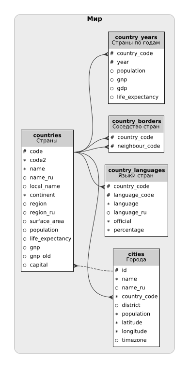

# `wld` — набор «Мир»

Выпуск `wld-data-v1`: справочник стран и городов мира из открытых источников — GeoNames, World Bank Open Data,
Unicode CLDR 49 и Wikidata: 5 таблиц — страны и территории (коды ISO, названия по-английски, по-русски и на языке
страны, часть света, подрегион ООН, площадь, население, продолжительность жизни, ВНП, столица),
города с координатами и поясом, языки стран, соседство, ряды по годам с 1960 года. Названия и числа — настоящие, как
в источниках на дату снимка. Что сделано с данными и какие поля в таблицах — `SOURCE.md` выпуска.

## Схема



Значки у полей: `#` — поле первичного ключа, `∗` — обязательное (NOT NULL), `○` — может быть пустым (NULL). Линия
связи идёт от поля к полю: «вилка» — у таблицы, где строк много, у таблицы «одного» значка нет; пунктир — ссылка может
быть пустой. У стран и городов связь в обе стороны: `countries.capital` → `cities` (столица может быть пустой),
`cities.country_code` → `countries`; внешние ключи DDL ставятся после загрузки (`schema-constraints.sql`), поэтому
кольцо не мешает.

Поля таблиц — [`schema/schema-fields.md`](schema/schema-fields.md). Картинку пишет генератор (`schema.dot`), рисует
Graphviz — `tools/schema-svg.sh wld`; та же картинка — в выпуске (`schema.svg`).

Генератор здесь — **импорт**: вход — снимок источников `wld-source-YYYYMMDD.zip` (выпуск этого репозитория), выход —
пять таблиц. Случайности нет: выпуск — функция снимка и профиля. Устроен по общему шаблону наборов (см. `README.md`
в корне): ядро — `core/`, сборка — `./build.sh wld`, проверка — `tools/check_data.py`, CI —
`.github/workflows/data.yml`. Java 25 без зависимостей (JUnit 5 — только для тестов).

## Раскладка

| путь | что |
|---|---|
| `dataset.properties` | паспорт набора: код, версия, профили, вход (`wld-source-20261123.zip` из выпуска `wld-source-20261123` и его `sha256`), окружение выпуска |
| `source/` | снимок источников: загрузчик `fetch.py` (только стандартная библиотека Python) и его тесты без сети `test_fetch.py`; запускает CI `.github/workflows/source.yml` по тегу `wld-source-YYYYMMDD`, выпуск снимка — после одобрения в том же окружении `wld-data-release` |
| `src/main/java/io/hammerhall/data/wld/` | `WldDataset` (контракт с ядром), `Main`, схема `WldSchema`, тексты выпуска `WldDocs` (SOURCE.md и LICENSE), списки `Exclusions` |
| `…/wld/source/` | чтение снимка: `Snapshot` (zip и вложенные zip GeoNames потоком), `GeoNames`, `WorldBank` (страницы ответа API в `.jsonl`), `Cldr`, `Wikidata` и `Csv` (RFC 4180), всё вместе — `SourceData`; `SnapshotSource` — снимок прогона (разбирается один раз) |
| `…/wld/build/` | правила сборки `Rules` (по одному на пункт), набор целиком `World` (функция снимка, профиля и списков исключений), модуль `WorldModule` (пять таблиц и самопроверка) |
| `src/test/java/io/hammerhall/data/wld/` | тесты JUnit 5: общие тесты набора (`WldContractTest`), правила по одному (`RulesTest`), CSV (`CsvTest`), набор из крошечного снимка (`WorldTest`), выпуск целиком и тексты (`WldReleaseTest`); крошечный снимок для тестов — `TinySnapshot` |
| `schema/` | DDL выпуска (`schema-tables.sql`, `schema-constraints.sql`), ER-диаграмма `schema.mmd`, поля `schema-fields.md`, картинка схемы `schema.dot` — генерируются командой `schema`; тест и CI сверяют их с генератором; `schema.svg` — из `schema.dot` (`tools/schema-svg.sh wld`), тест сверяет отметку sha256 |
| `expected/` | ожидания выпуска по профилям (`wld-data-v1-small.json`, `wld-data-v1-medium.json`, `wld-data-v1-full.json`) — из настоящего снимка |
| `pom.xml` | модуль Maven `wld-gen` (для IDE; сборка — `build.sh` в корне) |

## Сборка

Из корня репозитория; нужны JDK 25 (`JAVA_HOME`) и bash (на Windows — Git Bash).

```bash
./build.sh wld            # собрать ядро и набор (предупреждения — ошибки) и прогнать тесты
./build.sh wld compile    # только собрать
```

Тестам снимок не нужен: без него вход — крошечный снимок, который тест пишет сам (`TinySnapshot`; всё в нём
выдумано). С настоящим (`WLD_SOURCE`, `-Dwld.source=…` у Maven или `wld/work/wld-source-20261123.zip`) общие тесты
собирают `small` из него.

## Генерация

```bash
./build.sh wld run generate --profile small --out wld-data-v1-small --source wld-source-20261123.zip
./build.sh wld exec generate --profile full --out wld-data-v1 --source wld-source-20261123.zip --inputs strict
```

`--source ПУТЬ` — иначе `WLD_SOURCE` или `wld/work/wld-source-20261123.zip`. `--inputs strict` — sha256 снимка обязан
совпасть с паспортом, имя снимка в его `fetch.json` — с `WldDataset.SNAPSHOT`. `--seed` на содержимое не влияет
(случайности нет). `--to` не принимается: окно задаёт снимок (1960 — дата снимка). Куча — `JAVA_XMX`; `full` укладывается
в 2 ГБ.

| профиль | города | строк городов | всего строк | сжато |
|---|---|--:|--:|--:|
| `small` | население от 100 000 и все столицы | 5 891 | 22 424 | ≈ 0,5 МБ |
| `medium` | от 15 000 и все столицы | 31 623 | 48 156 | ≈ 1,2 МБ |
| `full` | от 1 000 и все столицы | 138 355 | 154 888 | ≈ 3,8 МБ |

Страны (244), языки (1 607), соседство (624 пары) и ряды по годам (14 058 строк) — одни во всех профилях. Числа — по
снимку `wld-source-20261123`; точные — в `expected/`.

### Снимок источников

Снимок собирает CI (из песочницы источники не видны) и кладёт в выпуск `wld-source-YYYYMMDD`: zip без общей папки,
записи по имени, время записей — 1980-01-01. Внутри:

| путь | что |
|---|---|
| `fetch.json`, `SOURCE.md`, `SHA256SUMS` | имя и время снимка, адреса и суммы файлов, источники и лицензии |
| `geonames/countryInfo.txt`, `admin1CodesASCII.txt`, `cities500.zip`, `capitals/<CC>.zip` | GeoNames как есть; `capitals/` — выгрузки стран, у которых в cities500 нет строки столицы |
| `worldbank/<показатель>.jsonl`, `countries.jsonl` | ответы API World Bank: строка — страница ответа; показатели `SP.POP.TOTL`, `NY.GNP.MKTP.CD`, `NY.GDP.MKTP.CD`, `SP.DYN.LE00.IN`, `AG.SRF.TOTL.K2`; метаданные — `indicators/`, `metadata/` |
| `cldr/cldr-core/…`, `cldr/cldr-localenames-full/…` | пакеты npm CLDR 49 (и сами `.tgz` в `cldr/npm/`): `territoryInfo.json`, `territoryContainment.json`, названия территорий, языков и письменностей по локалям, `LICENSE` |
| `wikidata/cities_ru.csv`, `languages.csv` | ответы SPARQL: русские названия городов, названия языков (тексты запросов — `wikidata/queries/`); прочие файлы `wikidata/` снимка сборка не читает |

## Правила

По одному месту в коде на правило (`Rules`, `World`); модульные тесты — на каждое.

* **Страны** — строки `countryInfo.txt`, чей ISO2 есть среди территорий CLDR `en` (так отпадают исторические записи
  справочника) и не в списке `Exclusions.COUNTRIES`. Название — CLDR `en` / `ru`, часть света — по коду GeoNames,
  подрегион ООН — запись `territoryContainment` с числовым кодом (не группировка, не устаревшая), иначе буквенная
  (`QO`). `local_name` — первый официальный язык (`official`, `de_facto_official`; по убыванию доли, затем по коду), в
  чьей локали (`xx-Yyyy`, нет её — `xx`) есть название страны.
* **Числа World Bank** — последнего года с данными у страны и показателя: население; продолжительность жизни
  (half-even, 3 знака); ВНП (GNI) — млн долларов (half-even, 2 знака) и `gnp_old` — за год до него. Округление — по
  десятичной записи источника. Площадь — World Bank, нет у страны данных совсем — GeoNames; население — так же
  (GeoNames — в обоих случаях, если больше нуля). Агрегаты World Bank — не страны.
* **Столица** — среди городов страны без учёта порога (класс `P`, код годится, не в исключениях): `PPLC` с названием
  `Capital` (`name`, `asciiname` или одно из `alternatenames`), иначе единственная `PPLC`, иначе город с этим названием —
  больше население, затем меньше geonameid. Пустой `Capital` или ничего — пусто.
* **Города** — `cities500.txt` и `capitals/*.zip` (при повторе geonameid — строка cities500), класс `P`, кроме кодов
  `PPLX PPLH PPLQ PPLW PPLCH`, страна — из набора, не в `Exclusions.REGIONS` (`CC.ADM1`) и `Exclusions.CITIES`
  (geonameid); население от порога профиля или столица. `name_ru` — метка Wikidata элемента с наименьшим Q;
  `district` — `admin1CodesASCII.txt`; координаты — значение источника точно (запись — без хвостовых нулей; больше
  7 знаков — ошибка сборки, а не округление).
* **Языки** — все языки страны из `territoryInfo`; название — CLDR по коду, иначе базовый язык + « (письменность)»,
  иначе метка Wikidata (`languages.csv`, ISO 639-3) базового кода; без английского названия строку не берём.
* **Соседство** — пара в обе стороны, если хотя бы одна страна перечисляет другую и обе в наборе.
* **Ряды по годам** — с 1960 по последний год данных, строка — если есть хоть одно из четырёх значений.

Списки исключений (`Exclusions`) — только коды; их записей, городов и соседств в наборе нет. На страну списки регионов
и городов не влияют (население и площадь — как в источнике).

Поля, чьё содержание взято из источника без изменений (коды, названия стран, городов, регионов и языков, пояса),
помечены в `WldSchema` `verbatimSource()`: проверка внутренних имён выпуска (`names`, тест контракта) их значения
пропускает — настоящие названия мест могут содержать любые сочетания букв. Заголовки, тексты выпуска, прочие поля и
весь репозиторий проверяются как обычно.

## Тождество и проверка выпуска

Как у всех наборов (см. `README.md` в корне): тождество — `rows` и `sha256_tsv` таблиц, поля манифеста кроме списка
файлов (имя и sha256 снимка — тоже), тексты без сжатия, агрегаты. Проверка скачанного выпуска:

```bash
python3 -X utf8 -I tools/check_data.py ПАПКА_ВЫПУСКА        # Linux, macOS
py -3 -X utf8 -I tools\check_data.py ПАПКА_ВЫПУСКА          # Windows
./build.sh wld exec check ПАПКА_ВЫПУСКА                     # то же — генератором
```

Загрузка в Postgres —
`psql -v ON_ERROR_STOP=1 -d БАЗА -f schema-tables.sql -f load-postgres.psql -f schema-constraints.sql` из папки
выпуска; проверка во временном Postgres 16 — `tools/pg-check.sh ПАПКА_ВЫПУСКА`.

## Новый выпуск

1. Снимок источников — выпуск `wld-source-YYYYMMDD` этого репозитория; имя — в `WldDataset.SNAPSHOT` (дата окна —
   из него) и в `dataset.properties` (`input.source.file`, `input.source.release`); sha256 файла — в паспорте
   (`input.source.sha256`) и в `WldDataset.SOURCE`.
2. Изменили генератор или списки исключений так, что меняется содержимое, — новая версия генератора
   (`WldDataset.GENERATOR_VERSION`).
3. Ожидания: `./build.sh wld exec freeze ПАПКА` для `small`, `medium` и `full` (или ручной запуск workflow `data` с
   набором `wld` — артефакты `expected-*`); схема — `./build.sh wld exec schema`, картинка — `tools/schema-svg.sh wld`.
   Всё — в коммит.
4. Тег `wld-data-vN` → CI собирает и проверяет; выпуск — после одобрения в окружении `wld-data-release`.

## Лицензия

Данные — под лицензиями источников: GeoNames и World Bank Open Data — CC BY 4.0, Unicode CLDR — Unicode License v3,
Wikidata — CC0 (тексты и указание авторства — `LICENSE` и `SOURCE.md` выпуска). Генератор — MIT.
